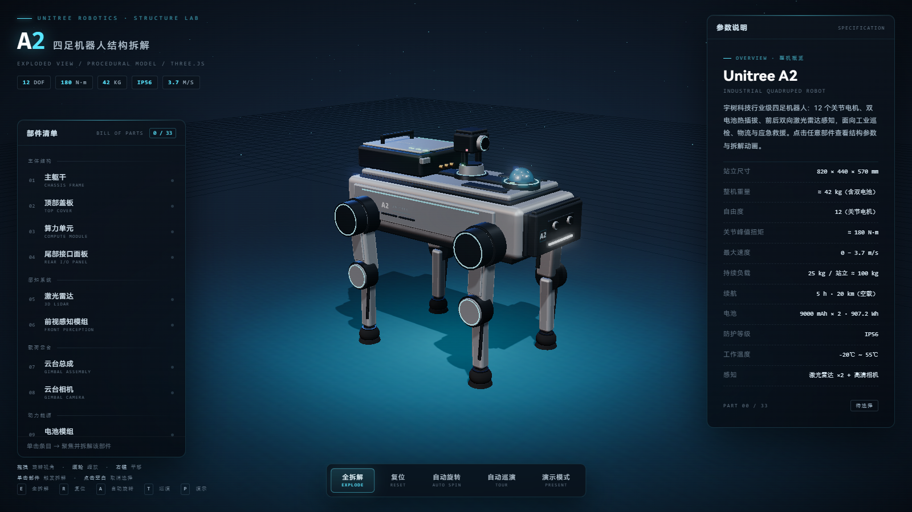
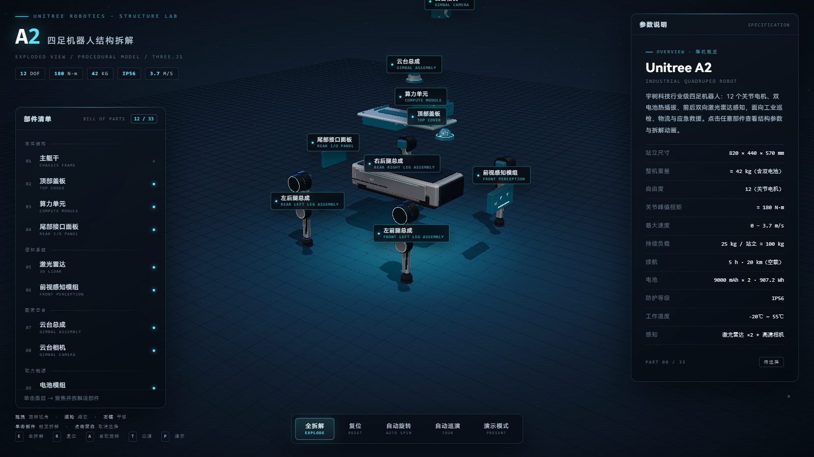

# Unitree A2 · 四足机器人三维结构拆解可视化

> 单文件、零依赖、可离线运行的 WebGL 交互式数字样机。所有几何体由代码程序化生成，不加载任何外部 3D 模型文件。





## 在线体验

开启 GitHub Pages 后访问：`https://<你的用户名>.github.io/<仓库名>/`

页面本身是一个 779 KB 的 HTML 文件，**Three.js r160 已内嵌**，不请求任何 CDN，断网也能跑。

## 功能

| 能力 | 说明 |
|---|---|
| 程序化建模 | 33 个可交互部件，13 个主总成 + 20 个腿部子件，与官方 12 DOF 布局对应 |
| 点击拆解 | 单击部件 → 沿独立方向拆出 + 青色发光高亮 + 悬浮标签 + 右侧参数面板 |
| 自由视角 | 左键拖拽旋转 / 滚轮缩放 / 右键平移，OrbitControls 惯性阻尼 |
| 自动取景 | 按部件包围盒投影求解机位，大件拉远、小件贴近，避免裁切与贴脸 |
| 演示模式 | `P` 全屏演示，隐藏侧栏，只留标题与底部控制条 |
| 自动巡演 | `T` 15 步讲解：整机亮相 → 13 个总成逐个聚焦拆解 → 全爆炸总览，自动循环 |
| 标签防重叠 | 屏幕矩形相交时按「选中 > 悬停 > 主件」优先级自动淡出 |

## 快捷键

| 键 | 作用 |
|---|---|
| `P` | 演示模式（全屏 + 隐藏面板） |
| `T` | 开始 / 结束自动巡演 |
| `←` `→` | 巡演中手动换页 |
| `空格` | 暂停 / 继续 |
| `E` | 全拆解 |
| `R` | 复位 |
| `A` | 自动旋转 |
| `ESC` | 取消选择 / 退出演示 |

也可以直接在地址栏加 hash 跳过键盘：`#demo` 进演示态，`#tour` 进演示态并开始巡演。

## 部件清单

- **主体结构** — 主躯干（承力框架 / 侧装甲 / 散热格栅）、顶部盖板、算力单元、尾部接口面板
- **感知系统** — 工业级激光雷达（玻璃罩 + 内部扫描头）、前视感知模组（双目 + 补光）
- **载荷云台** — 双轴云台总成（偏航 + 俯仰）、云台相机
- **能源** — 双仓电池模组（提手 / 电量灯 / 金属触点）
- **腿部总成 × 4** — 髋关节双电机、大腿连杆、膝关节电机、小腿连杆、橡胶球足

## 技术栈

- Three.js r160（ESM，经 esbuild 打包为 IIFE 内联，MIT）
- OrbitControls / CSS2DRenderer / RoundedBoxGeometry / RoomEnvironment
- EffectComposer + RenderPass + UnrealBloomPass + OutputPass（辉光与色调映射）
- 纯 HTML / CSS / 原生 JavaScript，无构建依赖、无框架、无后端

## 本地使用

```bash
# 直接双击 index.html，或
python -m http.server 8000   # 然后访问 http://127.0.0.1:8000/
```

需要浏览器开启硬件加速（WebGL）。若提示渲染器初始化失败，在 Chrome 访问 `chrome://gpu` 确认 WebGL 为 Enabled。

## 说明

结构尺寸与参数参考宇树 Unitree A2 公开资料整理；模型为**程序化示意建模**，非官方 CAD 数据，仅用于结构原理演示、教学与讲解。

## License

代码以 MIT 协议开源，详见 [LICENSE](LICENSE)。随附的 Three.js 遵循其自身 MIT 协议，见 [NOTICE](NOTICE)。
